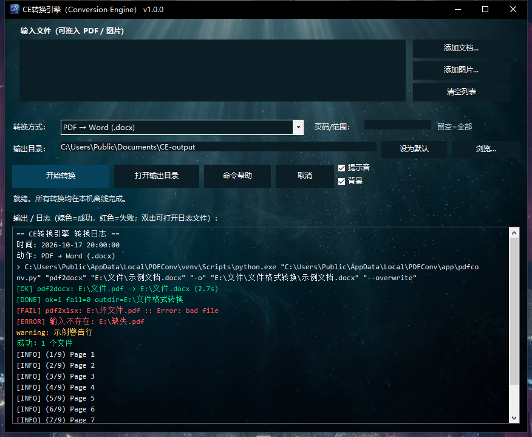

# CE转换引擎（Conversion Engine）— 本地离线 PDF/OFD/WPS 转换工具

**版本：v1.0.0** · [GitHub 仓库](https://github.com/ThePandaQ/ce-conversion-engine) · 许可证：AGPL-3.0

在 **Windows / Python 3.10+** 上运行的独立 PDF/OFD/WPS 转换 CLI，全部转换在本机完成、不联网、不依赖 WPS（`.wps` 格式除外，见下文）。
使用开源引擎实现：PyMuPDF、pypdf、pdfplumber、pdf2docx、python-docx、python-pptx、openpyxl、Pillow、RapidOCR、easyofd（OFD）；
`.wps` 格式通过本机 WPS Office 的 COM 自动化桥接（pywin32）。



> 与 WPS 的关系：本工具是**独立重建**（clean-room，仅调用开源库），不包含/不复制 WPS 代码，不调用 WPS 的 VIP 转换引擎，不绕过任何付费校验。

## 安装

```powershell
git clone https://github.com/ThePandaQ/ce-conversion-engine.git
cd ce-conversion-engine
powershell -ExecutionPolicy Bypass -File .\install.ps1
```

如果不想用 git，也可以直接下载仓库 ZIP 解压后运行 `install.ps1`。

安装内容：
- 独立 venv：`%LOCALAPPDATA%\PDFConv\venv`
- 程序：`%LOCALAPPDATA%\PDFConv\app\pdfconv.py`
- 启动器：`%LOCALAPPDATA%\PDFConv\pdfconv.cmd`
- 用户 PATH 追加 `%LOCALAPPDATA%\PDFConv`（幂等；`-NoPath` 可跳过；`-SkipDeps` 跳过依赖安装）
- 首次安装约下载 100–200MB（PyMuPDF / OCR 模型等）
- 依赖：PyMuPDF、pypdf、pdfplumber、pdf2docx、python-docx、python-pptx、openpyxl、Pillow、RapidOCR、**easyofd（OFD 支持）**、**pywin32（WPS .wps 桥接）**
- 图标：使用原参考图（3D 玻璃图标）**裁去四角圆角外底色**（四角透明、保留完整图标本体的圆角方形），
  保存为 `desktop\icon-source-clean.png`；`make_icon.py` 据此生成多尺寸 `ce.ico`
  （16/24/32/48/64/128/256）；安装时复制到 `app\ce.ico`，用于窗口标题栏、任务栏和桌面快捷方式
- 版本号：根目录 `VERSION` 文件（当前 1.0.0），安装后显示在窗口标题栏

> 安装后如果当前终端提示找不到 `pdfconv`：这是 Windows 环境变量缓存导致的，**新开一个终端/重新登录**即可；
> 也可以直接用绝对路径：`%LOCALAPPDATA%\PDFConv\pdfconv.cmd doctor`。

卸载：删除 `%LOCALAPPDATA%\PDFConv`，并从用户 PATH 中移除该目录即可（`uninstall.ps1` 未内置，避免误删）。

## 桌面快捷方式（推荐入口）

安装脚本会在**桌面**创建快捷方式：**`CE转换引擎（Conversion Engine）`**（使用新的 3D 玻璃图标）。
> 命令行工具名仍为 `pdfconv`（保持兼容），界面/快捷方式显示名称为 **CE转换引擎（Conversion Engine）**。

- **双击**：打开图形界面（28 种转换动作；选文件、选输出目录、点“开始转换”）
- **拖放**：把 PDF/图片直接拖到**窗口**里，或拖到**桌面快捷方式图标**上，都会自动加入输入列表
- 默认输出目录：`桌面\pdfconv-output`（可改）
- 界面里的“页码/范围”可留空（全部），例：`1-3,5`
- **提示音**：转换成功播放“上行双音”，失败播放“下行低音”；界面右侧“提示音”勾选框可关闭，
  设置保存在 `%LOCALAPPDATA%\PDFConv\settings.json`，下次打开仍生效。
- **日志**：每次转换的完整日志（UTF-8）保存到 `%LOCALAPPDATA%\PDFConv\logs\run-*.log`；
  日志区**双击**可用记事本打开；**右键**可“复制全部日志”；自动保留最近 30 个日志文件。
  日志行会按窗口宽度**自动换行**，只保留右侧竖向滚动条（无底部横向滚动条）。
- **状态栏**：位于按钮行下方、整行显示（自动换行），完成/失败信息完整可见，不再被截断。
- **彩色日志**：日志区成功行（`[OK]`、`[DONE] ... fail=0`、`成功`）显示**绿色**，
  失败/错误行（`[FAIL]`、`[ERROR]`、`Traceback`、`Exception`、`失败`）显示**红色**，警告为橙色；
  状态栏也同步显示绿/红。
- **默认输出目录**：在“输出目录”填好路径后点 **“设为默认”**，之后每次打开自动填入该目录；
  配置写入 `%LOCALAPPDATA%\PDFConv\settings.json`（与提示音、背景开关共用）。
- **照片背景**：水下光影照片**铺满整个窗口**（输入区、按钮区、日志区都能看到照片纹理），
  采用 cover 裁切，**窗口缩放/最大化时始终铺满、不留黑边**；照片上叠加薄暗层保证白色文字可读；
  右侧 **“背景”** 勾选框可随时开关，选择会被记住。
- **自适应配色**：输入列表、下拉框、路径框、按钮等深色控件的颜色会从背景照片对应区域**取样压暗**，
  并去掉边框，让它们看起来像照片上的深色玻璃层；窗口缩放时自动重新适配；
  **窗口标题栏也改为深色**（与背景深色调一致）；关闭背景时恢复默认深色。
- **按钮说明**：“打开输出目录”“取消”与其它按钮一样**始终白字可点**；若还没有可打开的目录、
  或当前没有进行中的转换，点击会在状态栏给出提示（不再出现灰字看不清的禁用态）。
- 卸载时删除桌面快捷方式即可

> 快捷方式实际调用：`powershell.exe -NoProfile -ExecutionPolicy Bypass -WindowStyle Hidden -File "%LOCALAPPDATA%\PDFConv\app\pdfconv-launcher.ps1"`

### 常见问题

- **双击后转换报错 `can't open file '...\PDFConv\pdf2docx'`**：这是旧版启动器的参数 bug，已在 2026-10-17 晚修复。
  关闭已打开的旧窗口，重新双击桌面快捷方式即可（安装目录里的 `app\pdfconv-launcher.ps1` 已更新）。
- **大文件转换时窗口“没反应”**：当前版本转换在后台子进程执行，状态栏每 0.5 秒刷新“已运行 Ns”，
  另有“取消”按钮可随时终止；PDF→Word 5 页复杂文档可能需要 2 分钟左右，属正常。
- **一直显示“转换中”、没进度（已修复）**：2026-10-17 晚修复了轮询计时器未启动的问题。
  如果仍遇到，请关闭窗口后重新双击快捷方式；转换产物通常已生成在所选输出目录。
- **想验证环境**：`pdfconv doctor`；或用绝对路径 `%LOCALAPPDATA%\PDFConv\pdfconv.cmd doctor`。

## 快速使用

```powershell
pdfconv doctor                                  # 检查依赖
pdfconv info report.pdf                         # 页数/尺寸/文字量/图片数

pdfconv pdf2png report.pdf --dpi 150            # 逐页 PNG -> report-png\
pdfconv pdf2jpg report.pdf --pages 1-3
pdfconv pdf2txt report.pdf                      # -> report.txt
pdfconv pdf2docx report.pdf                     # -> report.docx
pdfconv pdf2pptx report.pdf                     # 逐页整页 -> report.pptx
pdfconv pdf2xlsx report.pdf                     # 表格/文字 -> report.xlsx
pdfconv pdf2imgpdf report.pdf                   # 纯图/扫描型 PDF -> report-imgpdf.pdf

pdfconv ocr scan.pdf                            # 本地 OCR -> scan.ocr.txt + .json
pdfconv pdf2searchable scan.pdf                 # 本地 OCR 文字层 -> scan-searchable.pdf

pdfconv img2pdf a.png b.jpg -o photos.pdf       # 图片 -> PDF
pdfconv merge a.pdf b.pdf -o merged.pdf
pdfconv split big.pdf --every 10 -o split\      # 每 10 页一个
pdfconv split big.pdf --ranges "1-3,4-6" -o split\
pdfconv extract-pages big.pdf --pages 2-5,9 -o pages.pdf
pdfconv extract-images big.pdf -o images\       # 提取内嵌图片

pdfconv ofd2pdf notice.ofd                      # OFD -> PDF
pdfconv ofd2docx notice.ofd                     # OFD -> Word（经 PDF）
pdfconv ofd2xlsx notice.ofd                     # OFD -> Excel（经 PDF）
pdfconv ofd2pptx notice.ofd                     # OFD -> PPT（经 PDF）
pdfconv ofd2png notice.ofd --dpi 150            # OFD -> 逐页 PNG
pdfconv ofd2txt notice.ofd                      # OFD -> 文本
pdfconv pdf2ofd report.pdf -o report.ofd        # PDF -> OFD

pdfconv wps2docx legacy.wps                     # WPS -> Word
pdfconv wps2pdf legacy.wps                      # WPS -> PDF
pdfconv wps2txt legacy.wps                      # WPS -> 文本
pdfconv doc2wps report.docx -o report.wps       # Word/RTF/TXT -> WPS
pdfconv pdf2wps report.pdf -o report.wps        # PDF -> WPS
pdfconv ofd2wps notice.ofd -o notice.wps        # OFD -> WPS
```

通用参数：`-o/--out`、`--overwrite`、`--json`、`--quiet`、`--dry-run`。

## OFD 支持（2026-10-17 新增）

使用开源库 [easyofd](https://github.com/renoyuan/easyofd) 解析/生成 OFD，全部本地完成：

| 命令 | 说明 |
|---|---|
| `ofd2pdf` | OFD → PDF（保留文字/版式，适合归档与打印） |
| `ofd2docx` | OFD → Word（先转 PDF 再重排；可编辑但版式非 100% 还原） |
| `ofd2xlsx` | OFD → Excel（按页文字/表格；扫描版需 OCR 后处理） |
| `ofd2pptx` | OFD → PPT（逐页整页，视觉保真、文字不可编辑） |
| `ofd2png` / `ofd2jpg` | OFD → 逐页图片 |
| `ofd2txt` | OFD → 文本 |
| `pdf2ofd` | PDF → OFD（easyofd 生成；文字可能被栅格化） |

说明与限制：
- OFD 标准实现差异较大；easyofd 对常见公文/发票类 OFD 支持较好，个别特殊结构可能报错（可先用 `ofd2pdf` 验证）。
- OFD→Word/Excel/PPT 本质是“OFD→PDF→目标格式”，复杂版式建议优先用 PDF 或 PPT（整页保真）。
- 桌面 GUI：点“添加 PDF/OFD...”选择 `.ofd`，转换方式下拉框含全部 OFD 选项。

## WPS（.wps）格式支持（2026-10-17 新增）

`.wps` 是金山 WPS 文字的专有格式。本工具通过**本机已安装的 WPS Office COM 自动化**（`KWPS.Application`）读写 `.wps`，
不上云、不调用 WPS 的 VIP/云端转换引擎，只做本地打开/另存/导出。

| 命令 | 说明 |
|---|---|
| `wps2docx` | `.wps` → Word (.docx) |
| `wps2pdf` | `.wps` → PDF |
| `wps2txt` | `.wps` → 文本 TXT（UTF-8） |
| `wps2ofd` | `.wps` → PDF → OFD |
| `doc2wps` | Word(.doc/.docx)/RTF/TXT → `.wps` |
| `pdf2wps` | PDF → DOCX → `.wps` |
| `ofd2wps` | OFD → PDF → DOCX → `.wps` |

说明：
- 写出的 `.wps` 为 WPS 实际保存格式（OLE 容器，含 `WpsCustomData` 流），WPS 可直接打开；
- 需要本机安装 **WPS Office**（COM 可用）及 `pywin32`（安装脚本已包含）；
- 其他软件能否打开 `.wps` 取决于该软件对 WPS 专有格式的支持程度；
- 未安装 WPS 时执行这些命令会提示“未检测到 WPS Office（COM: KWPS.Application）”。

## 与 WPS「转换」18 项对照

| WPS 工具 | pdfconv 对应 | 说明 |
|---|---|---|
| 转为Word | `pdf2docx` | pdf2docx 重排；版式复杂时可能不如商业引擎 |
| 转为Excel | `pdf2xlsx` | pdfplumber 表格提取；无表格时文字回退 |
| 转为PPT | `pdf2pptx` | 逐页整页图片入幻灯片（保留视觉版式，不可编辑文字） |
| 转为图片 | `pdf2png` / `pdf2jpg` | 逐页渲染 |
| 转为TXT | `pdf2txt` | 文本层提取 |
| 转为CAD | ✗ | 需要 DWG/DXF 专有解析，无可靠开源实现 |
| 转为脑图 | ✗ | 依赖大模型/AI 服务（本工具坚持离线） |
| AI总结生图 | ✗ | 同上 |
| 转为OFD | `pdf2ofd` | 通过 easyofd 生成 OFD；反向 OFD→PDF/Office 见下方“OFD 支持” |
| 图片转PDF | `img2pdf` | Pillow |
| 转为扫描型PDF | `pdf2imgpdf` | 逐页渲染后重建纯图 PDF |
| CAD转PDF | ✗ | 同 CAD 限制 |
| CAJ转PDF | ✗ | CAJ 为专有格式 |
| 提取文字 | `pdf2txt` / `ocr` | 有文本层直接取；扫描件走本地 OCR |
| 提取页面 | `extract-pages` | pypdf |
| 提取表格 | `pdf2xlsx` | pdfplumber；扫描件表格需 OCR 后处理 |
| 提取图片 | `extract-images` | PyMuPDF 内嵌图片 |
| 扫描件识别 | `ocr` / `pdf2searchable` | RapidOCR 本地模型，离线 |

## 目录

```
ce-conversion-engine/
├─ pdfconv.py        # 单文件 CLI（安装时复制到 %LOCALAPPDATA%\PDFConv\app）
├─ install.ps1       # 安装脚本（venv + 依赖 + 启动器 + PATH + 快捷方式）
├─ VERSION           # 版本号
├─ CHANGELOG.md      # 更新记录
├─ LICENSE           # AGPL-3.0
├─ NOTICE.md         # 第三方依赖与许可
├─ README.md
├─ desktop/          # Windows 图形界面启动器、图标、背景图、快捷方式脚本
├─ docs/             # README 截图
└─ tests/
   ├─ make_samples.py     # 生成多页中文/表格/图片测试 PDF
   ├─ run_offline_test.py # 离线回归测试（报告输出到本地 artifacts/）
   └─ run_wps_test.py     # WPS .wps 桥接测试（需本机 WPS Office）
```

## 离线验证

`tests/run_offline_test.py` 会在**毒化代理**（`HTTP_PROXY/HTTPS_PROXY/ALL_PROXY` 指向不可达地址）环境下运行全部命令，
若任何步骤偷偷联网会立即失败；测试报告与每步输出/耗时写入本地 `artifacts/`（该目录不提交仓库）。

覆盖：PDF→PNG/JPG/TXT/DOCX/PPTX/XLSX、图片→PDF、纯图 PDF、合并/拆分/抽页/抽图、本地 OCR（RapidOCR）、
可搜索 PDF、OFD→PDF/Word/图片、PDF→OFD 回环。`tests/run_wps_test.py` 覆盖 `.wps` 双向转换（需 WPS Office）。

```powershell
python tests/run_offline_test.py
python tests/run_wps_test.py
```

## 许可证

本项目以 **GNU Affero General Public License v3.0（AGPL-3.0）** 发布，见 [LICENSE](LICENSE)。
第三方依赖与测试样本许可见 [NOTICE.md](NOTICE.md)。

- PyMuPDF 为 **AGPL-3.0**，与本项目许可证兼容；如需闭源/商用分发请自行评估或购买 PyMuPDF 商业授权。
- WPS、金山办公等商标归珠海金山办公软件有限公司所有；本项目与其无关联。
- `.wps` 转换依赖用户本机安装的 WPS Office，本项目不随附该软件。
